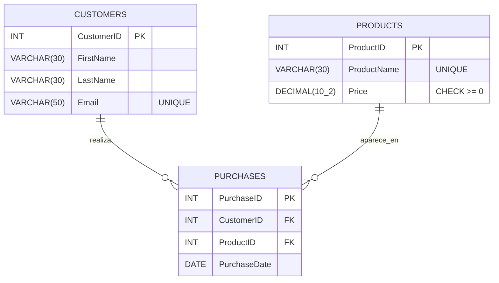
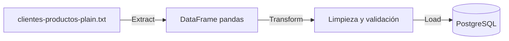

# Proceso ETL: carga de clientes y productos en PostgreSQL

Proyecto del **Máster Universitario en Análisis de Datos Masivos (Big Data)** de la Universidad Europea de Madrid, asignatura *Bases de datos de nueva generación* (curso 2026-2027).

Se diseña una base de datos relacional para una tienda de ropa que gestiona sus **clientes**, sus **productos** y las **compras** que realizan, y se implementa un proceso **ETL en Python** que lee los datos de un fichero de texto, los limpia y los carga en PostgreSQL.

**Palabras clave:** bases de datos relacionales · SQL · PostgreSQL · normalización 3NF · ETL · pandas · SQLAlchemy

---

## Estructura del repositorio

```
ETL_PostgreSQL-Practica/
├── README.md
├── requirements.txt
├── .env.example                 # plantilla de credenciales
├── .gitignore
├── sql/
│   ├── creacion_esquema.sql     # DDL de las tablas
│   └── consultas_ejemplo.sql    # consultas de análisis sobre los datos cargados
├── src/
│   └── carga_datos.py           # script ETL
└── data/
    └── clientes-productos-plain.txt   # datos de origen (ficticios)
```

---

## Modelo de datos

Clientes y productos mantienen una relación **N:M** (un cliente puede comprar muchos productos y un producto puede ser comprado por muchos clientes). Al normalizar, la relación se resuelve con la tabla intermedia `Purchases`, que deja el modelo en **Tercera Forma Normal (3NF)**.



**Restricciones principales**

- Las claves primarias son `IDENTITY`: las genera PostgreSQL automáticamente.
- El nombre y el apellido del cliente son obligatorios, y el email es único.
- El nombre del producto es obligatorio y único, y el precio no puede ser negativo (se admite 0 para artículos de regalo).
- Cada compra debe referenciar un cliente y un producto existentes (claves foráneas).

---

## Proceso ETL



**1. Extracción.** Se lee el fichero de texto delimitado por comas con `pandas`.

**2. Transformación.**
- Eliminación de filas duplicadas.
- Descarte de líneas con precio negativo.
- Eliminación de espacios en blanco y normalización del email a minúsculas.
- Separación en un conjunto único de clientes (por email) y de productos (por nombre).

**3. Carga.** Todo se ejecuta dentro de **una única transacción**: si algo falla, no se inserta nada.
1. Se insertan los clientes (`ON CONFLICT (email) DO NOTHING` para no duplicar).
2. Se insertan los productos (`ON CONFLICT (productname) DO NOTHING`).
3. Se recuperan los IDs generados por la base de datos.
4. Cada línea del fichero se convierte en una compra con su `customerid` y `productid`, y se inserta en `purchases`.

El orden clientes → productos → compras garantiza la integridad referencial.

> El fichero de origen no incluye la fecha de compra, por lo que `PurchaseDate` queda a `NULL`.

---

## Requisitos

Versiones con las que se desarrolló y probó el proyecto:

| Herramienta | Versión |
|---|---|
| Python | 3.13.9 (Anaconda, Windows 64 bits) |
| PostgreSQL | 18 |
| pandas | 3.0.3 |
| SQLAlchemy | 2.0.48 |
| psycopg | 3.x (driver `postgresql+psycopg`) |
| python-dotenv | cualquier versión reciente |

---

## Cómo ejecutarlo

**1. Clonar el repositorio**

```bash
git clone https://github.com/Markint86/ETL_PostgreSQL-Practica_2.git
cd ETL_PostgreSQL-Practica_2
```

**2. Crear un entorno virtual e instalar dependencias**

```bash
python -m venv .venv
# Windows
.venv\Scripts\activate
# Linux / macOS
source .venv/bin/activate

pip install -r requirements.txt
```

**3. Crear la base de datos y el esquema**

Crea una base de datos en PostgreSQL (por ejemplo, `Actividad BBDNG`) y ejecuta `sql/creacion_esquema.sql` desde pgAdmin o con `psql`:

```bash
psql -U postgres -d "Actividad BBDNG" -f sql/creacion_esquema.sql
```

**4. Configurar las credenciales**

Copia `.env.example` como `.env` y rellena tus datos de conexión. El fichero `.env` está en `.gitignore` y no se sube al repositorio.

**5. Ejecutar el ETL**

```bash
python src/carga_datos.py
```

Salida esperada:

```
Carga completada: 49 clientes, 8 productos, 49 compras.
```

---

## Consultas de ejemplo

En `sql/consultas_ejemplo.sql` hay varias consultas de análisis sobre los datos cargados:

- Clientes que compraron un producto concreto.
- Número de productos distintos comprados por cada cliente.
- Productos comprados por cada cliente.
- Ranking de productos más vendidos con `RANK() OVER`.

---

## Autor

**Marcos Quintas Pérez**
Máster Universitario en Análisis de Datos Masivos (Big Data), Universidad Europea de Madrid.
